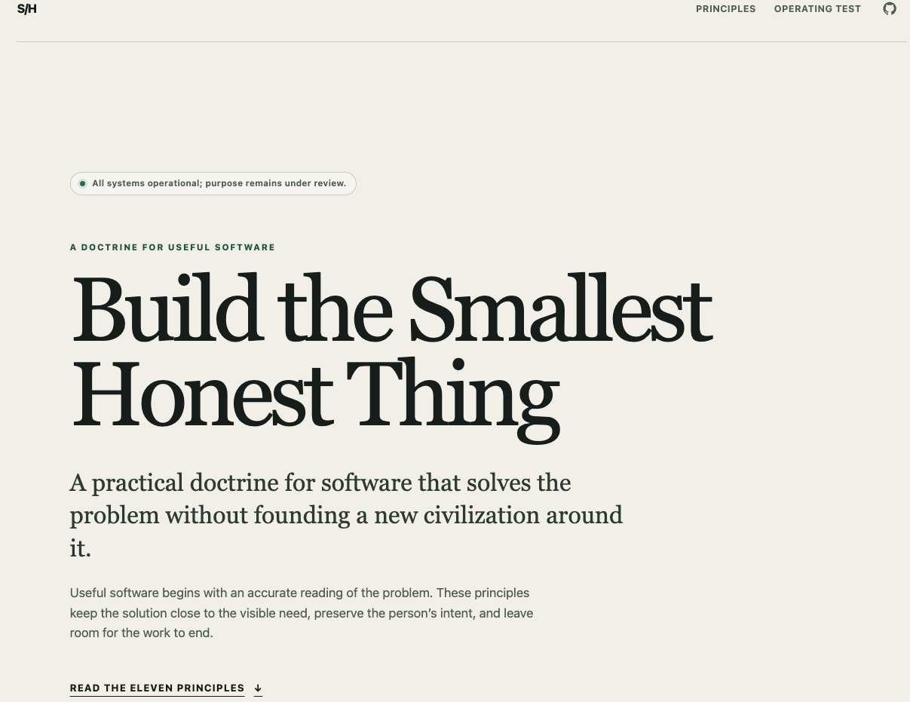

# Overengineered

Overengineered is a policy-aware, observable, multi-runtime doctrinal delivery platform for distributing constrained software judgment across heterogeneous presentation surfaces.

It is also a one-page website.



It provides a governed path from canonical content custody through domain evaluation, REST serialization, GraphQL translation, server rendering, telemetry, and eventual human comprehension. Select a route according to your conceptual role:

| Route                      | Entry point                                                          | Expected outcome                                           |
| -------------------------- | -------------------------------------------------------------------- | ---------------------------------------------------------- |
| Operator                   | [`docs/operations/README.md`](docs/operations/README.md)             | Preserve regional insight availability.                    |
| Contributor                | [`CONTRIBUTING.md`](CONTRIBUTING.md)                                 | Change the platform without casually changing its meaning. |
| Platform                   | [`docs/architecture/containers.md`](docs/architecture/containers.md) | Understand runtime custody.                                |
| Architecture               | [`docs/architecture/README.md`](docs/architecture/README.md)         | Review boundaries and concentration risks.                 |
| Governance                 | [`docs/governance/README.md`](docs/governance/README.md)             | Assume and record an appropriate conceptual hat.           |
| AI-assisted change         | [`docs/ai/README.md`](docs/ai/README.md)                             | Produce evidence before directness is permitted.           |
| Emergency purpose recovery | [`docs/product/history/README.md`](docs/product/history/README.md)   | Recover intent after normal abstraction paths fail.        |

## Local activation

```bash
pnpm install
pnpm dev
```

The public surface is available at `http://localhost:3000`. API, gateway, and worker operate on adjacent ports. `pnpm doctrine` reports complexity accounting; `pnpm ci:local` assembles the local evidence packet.

Turborepo orchestrates day-to-day execution and caching. Nx maintains the project graph, affected analysis, and dependency interpretation. Using only one would create an unacceptable single-framework concentration risk. Make, Task, Just, and package scripts serve institutional continuity, structured orchestration, humane aliases, and actual execution respectively.

## Vercel deployment

Create one Vercel project for the public site with these project settings:

- Root Directory: `apps/web`
- Include source files outside Root Directory: enabled
- Framework: Next.js
- Environment variables:
  - `DOCTRINE_SOURCE=local`
  - `ENABLE_DOCTRINAL_FALLBACK=true`

Only `apps/web` is deployed. The API, gateway, worker, docs application, and infrastructure stacks are not part of this deployment.

## Rationale

The documentation begins with platform capability because prematurely stating the simple product objective would collapse optionality before readers have selected a governed navigation path.
