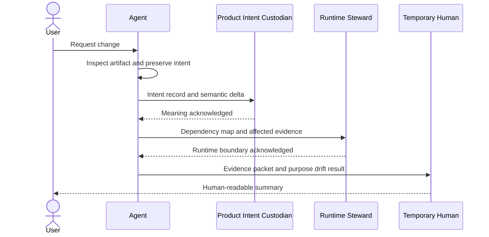

# AI-Assisted Change Approval

## Purpose

Map evidence and conceptual hats to assisted-change approval.

## Scope

Class 2 through 5 assisted changes.

## Non-goals

Sequential acknowledgment does not create multiple humans.

## Operational impact

One maintainer may hold all roles but records conceptual hat transitions.

## Failure modes

The same person may disagree with themself asynchronously.

## Rationale

Automated assistance should preserve accountability even when accountability occupies one chair.
