# AI Operating Model

## Purpose

Define the interpretive sequence for assisted changes.

```mermaid
flowchart LR
  Request[User Request] --> Failure[Visible Failure Statement] --> Inspection[Artifact Inspection] --> Intent[Intent Preservation Record] --> Premise[Premise Challenge] --> Class[Change Classification] --> Impact[Dependency Impact Map] --> Implementation --> Evidence[Evidence Collection] --> Drift[Purpose Drift Check] --> Summary[Human-Readable Summary]
```

## Scope

All agent-authored changes.

## Non-goals

The model does not replace human judgment with form completion.

## Operational impact

A direct change may remain direct only after the agent has documented why indirect implementation is unnecessary.

## Failure modes

Repeated correction indicates interpretation failure, not insufficient user detail.

## Rationale

Faithful assistance requires traceable decisions, even when tracing overwhelms the decision.
