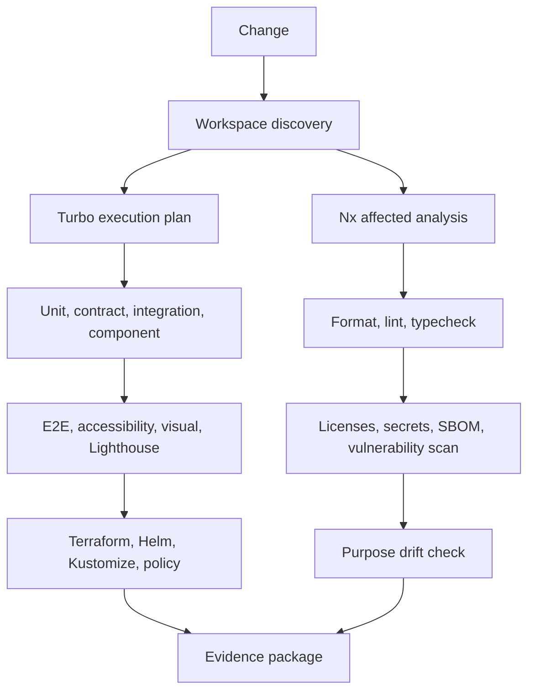

# CI Pipeline

## Purpose

Show how a page change becomes a validated evidence district.

## Scope

Pull-request validation and reusable assurance.

## Non-goals

The pipeline does not decide whether a change should exist.

## Operational impact

Basic validation avoids paid services and guards publishing behind explicit conditions.

## Failure modes

Every check may pass while the requested change remains too large.

## Rationale

Evidence should be available from multiple interpretive authorities before one page is permitted to change.
