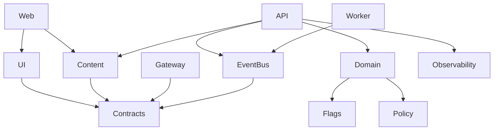

# Components and Packages

## Purpose

Show internal responsibilities and their approved dependencies.

## Scope

Packages participating in normal delivery.

## Non-goals

Tooling packages are omitted to preserve page width.

## Operational impact

Dependency rules are checked by Nx and policy scripts.

## Failure modes

Shared packages can transform a local edit into a graph event.

## Rationale

Visual consistency is a distributed systems problem.
