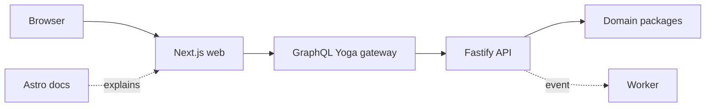

# Containers

## Purpose

Assign runtime custody.

## Scope

Five deployable applications.

## Non-goals

This diagram does not justify five deployable applications.

## Operational impact

Failures are isolated; comprehension is distributed.

## Failure modes

Translation may fail while the content remains correct.

## Rationale

Presentation requirements may evolve independently from canonical doctrine transport.
