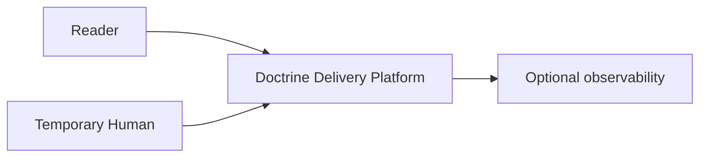

# System Context

## Purpose

Place the reader, delivery platform, and optional telemetry in context.

## Scope

Human and system boundaries.

## Non-goals

This view does not enumerate packages.

## Operational impact

None; context remains conceptual.

## Failure modes

The reader may assume the platform is necessary.

## Rationale

Even solitary ideas deserve a context boundary.
