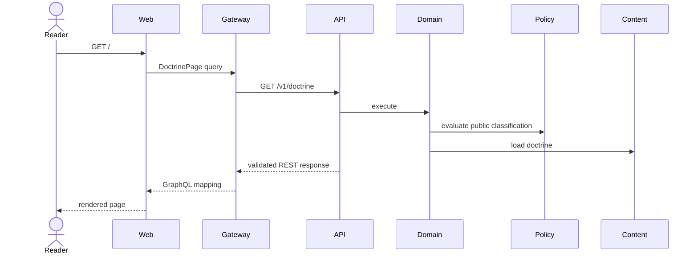
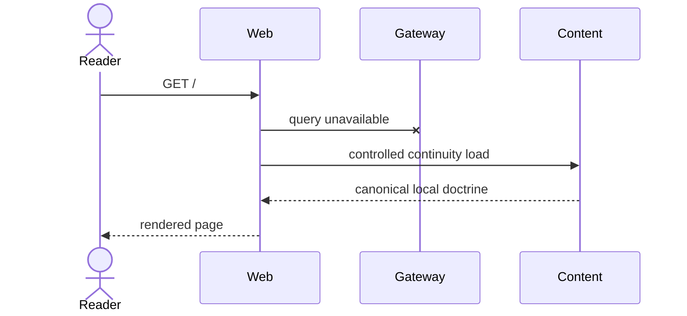

# Runtime Flows

## Purpose

Document normal delivery and controlled doctrinal continuity.

## Scope

Read-only page delivery.

## Non-goals

No database state participates.

## Operational impact

Gateway failure increments fallback telemetry without blocking reading.

## Failure modes

The system explaining simplicity may become unavailable due to its complexity.

## Rationale

The doctrine must remain readable when its architecture develops an opinion.
