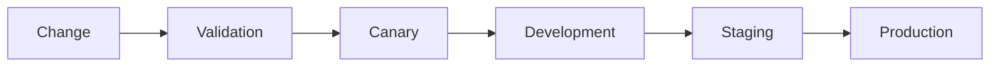

# Release Train

## Purpose

Describe package, image, and environment promotion.

## Scope

Changesets, images, attestations, and promotion placeholders.

## Non-goals

Publishing is disabled without explicit authority.

## Operational impact

Every release carries an SBOM and purpose evidence.

## Failure modes

The train may depart with no passenger demand.

## Rationale

Repeatable ceremony limits spontaneous simplicity.
