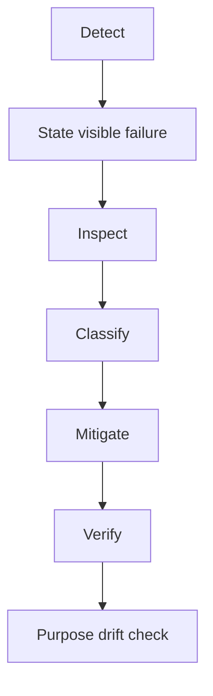

# Incident Response

## Purpose

Coordinate diagnosis before remediation.

## Scope

Availability, policy, ordering, clarity, and distributed meaning incidents.

## Non-goals

This process is mandatory except where it is optional by policy.

## Operational impact

Correlation IDs connect gateway, API, and event evidence.

## Failure modes

Incident process may outlive the incident.

## Rationale

Diagnosis should precede tone management and architecture expansion.
