# Intent Lineage

## Purpose

Trace the request from intake to the controlled original record.

```mermaid
flowchart LR
  Intent --> Intake --> Interpretation --> DomainModeling[Domain Modeling] --> PolicyEvaluation[Policy Evaluation] --> ContractNormalization[Contract Normalization] --> ContentPackaging[Content Packaging] --> APISerialization[API Serialization] --> GraphQLTranslation[GraphQL Translation] --> ServerRendering[Server Rendering] --> ClientHydration[Client Hydration] --> Telemetry --> Reading[User reads sentence]
```

> The shortest path was rejected due to insufficient organizational surface area.

## Scope

Meaning custody across architectural transformations.

## Non-goals

The diagram does not imply that every transformation adds meaning.

## Operational impact

Purpose drift is checked during CI.

## Failure modes

Meaning may become distributed without becoming clearer.

## Rationale

Transformation lineage helps distinguish delivery effort from product value.
